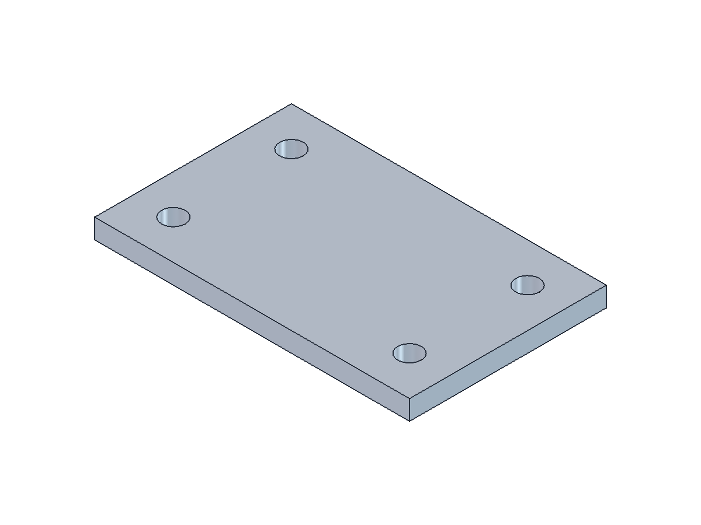
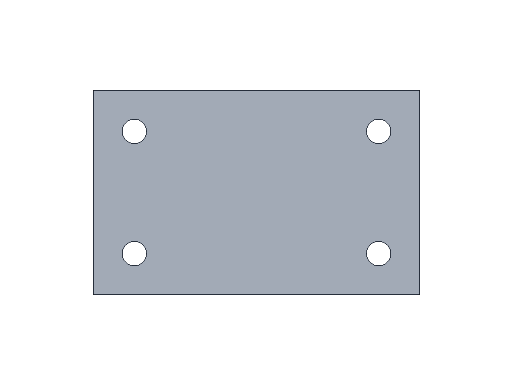

# LLM 3D Trajectory Data

保存三维建模任务的精简执行轨迹、模型、验收结果和截图。

## 样本

| ID | 工具 | 任务 | 轨迹 |
|---|---|---|---|
| freecad-mounting-plate-001 | FreeCAD 1.1.4 | 80×50×5 mm 四孔安装板 | [build-trajectory.json](data/freecad/mounting-plate-001/build-trajectory.json) |

原始任务：“使用FreeCAD创建一个80×50×5 mm 长方体，并在四个角各打一个3 mm的圆柱刀具孔，保留合理的间距”。

该样本将 **3 mm 解释为刀具半径，孔径为 6 mm**。四个孔中心为 (10,10)、(10,40)、(70,10)、(70,40) mm；孔中心距相邻板边 10 mm，孔壁距边 7 mm。

## 数据结构与验收

`build-trajectory.json` 包含完整脚本写入、实际执行、独立代码验收、FreeCAD GUI 截图、两次 `view_image` 查看及逐项视觉判断，共 19 条消息。顶层 `visual_acceptance` 可直接查看视觉验收；`messages` 保留动作顺序。部分工具封装已规范化，具体说明见 `provenance`。图片以文件路径和 SHA256 引用，没有内嵌图像数据；消费多模态轨迹时需加载 PNG。

- `geometry-acceptance.json`：从 FCStd、STEP 最终 B-rep 独立检查尺寸、孔径、孔位、间距和贯穿性。
- `visual-acceptance.json`：实际查看轴测图与俯视图后的视觉判断。
- `render-result.json`：截图生成结果，与视觉判断分别记录。
- `validation.json`：原始建模执行的体积、有效性、FCStd/STEP 重读及 STL 闭合检查。
- `mounting-plate.FCStd`、`.step`、`.stl`：原始交付模型；STL 按 mm 使用。
- `manifest.json`：文件大小及 SHA256，用于核对数据完整性。





## 复现

需要安装 FreeCAD；原执行环境为 macOS arm64、FreeCAD 1.1.4。进入样本目录后执行：

```sh
cd data/freecad/mounting-plate-001
python3 run_freecad.py demo_plate.py -- /absolute/path/new-output-directory
python3 run_freecad.py accept_geometry.py -- /absolute/path/new-output-directory
```

`demo_plate.py` 会拒绝覆盖已有模型。`run_freecad.py` 支持 `FREECAD_CMD` 或 `--executable` 指定命令行程序路径。Mac 沙箱可能导致 Qt 的 neon 检测失败，需在正常本机权限环境执行。

截图复现需可用图形桌面。`run_preview.py` 和 `render_preview.FCMacro` 是历史执行脚本；在独立副本目录中运行，已有 `render-result.json` 时启动脚本拒绝覆盖。截图脚本使用原本机 FreeCAD GUI 路径；在其他安装环境调整相应路径。它只关闭自己启动的 GUI 进程。图片生成后仍需实际查看，不能据渲染成功自动宣称视觉通过。

精确尺寸以几何检查为准；视觉判断覆盖轮廓、孔布局、显示遮挡及画面裁切。原始聊天日志未入库。
